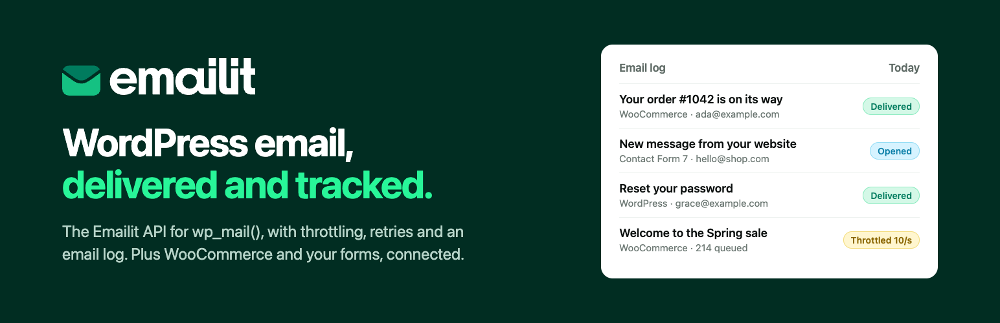

# Emailit for WordPress

The official [Emailit](https://emailit.com) plugin for WordPress. It sends every WordPress email through the Emailit API, with throttling, retries and an email log, and connects WooCommerce and your form plugins to Emailit contacts, audiences and automations.



- **Sending:** the Emailit API by default, or the SMTP relay. Works with every plugin that uses `wp_mail()`.
- **Throttling from Emailit's responses:** paces bursts to your per-second limit from the `ratelimit-*` headers, queues emails that wouldn't fit in today's limit until 00:00 UTC, honors `retry-after`, and sends at most 10 emails per page load before queueing the rest.
- **Retries:** timeouts, network errors, 429, 5xx, a rejected key or no credits put the email in a queue that retries for about 30 hours, with the same `Idempotency-Key` every time.
- **Email log:** every email with its sender plugin and delivery status (delivered, opened, clicked, bounced, complained) from a signed webhook the plugin sets up. Read and resend emails.
- **WooCommerce:** orders, products and carts in Emailit Commerce, abandoned cart recovery, a newsletter checkbox for the classic and block checkout, history import, and every WooCommerce email tagged with its type and order.
- **Forms:** Contact Form 7, WPForms, Gravity Forms, Elementor Pro, Ninja Forms, Fluent Forms, Formidable Forms and Forminator submissions become contacts, audience subscribers and `c:form_submitted` events.
- **Users:** new WordPress users become contacts tagged with their role.

Install it from [WordPress.org](https://wordpress.org/plugins/emailit/) or download the zip from [Releases](../../releases). The WordPress guide is at [emailit.com/docs/frameworks/wordpress](https://emailit.com/docs/frameworks/wordpress/).

## Requirements

WordPress 6.0 or later, PHP 7.4 or later, an Emailit account with a verified sending domain, and an API key. A Sending Only key sends email; a Full Access key also enables contacts, audiences, WooCommerce sync and automatic delivery tracking.

## Configuration in wp-config.php

```php
define( 'EMAILIT_API_KEY', 'secret_...' ); // Keeps the key out of the database.
define( 'EMAILIT_MAILER', 'api' );         // Or 'smtp'.
```

## For developers

Add metadata to any email with a header. It's sent to Emailit as metadata and never reaches the recipient:

```php
wp_mail( $to, $subject, $body, array( 'X-Emailit-Meta-Invoice: 2026-0142' ) );
```

| Hook | Type | Description |
| --- | --- | --- |
| `emailit_email_sent` | action | Emailit accepted an email (`$log_id`, `$message`, `$delivery`) |
| `emailit_email_queued` | action | An email was queued (`$log_id`, `$message`, `$reason`) |
| `emailit_webhook_event` | action | Any signed webhook event for this site |
| `emailit_webhook_<type>` | action | One event type, e.g. `emailit_webhook_email.bounced` |
| `emailit_email_payload` | filter | The `POST /v2/emails` body |
| `emailit_contact` | filter | A contact before it's sent to Emailit |
| `emailit_woocommerce_order` | filter | The Orders API body for a WooCommerce order |
| `emailit_woocommerce_product` | filter | The Products API body for a WooCommerce product |
| `emailit_retry_delays` | filter | Seconds before each retry |
| `emailit_inline_limit` | filter | Emails one page load sends before queueing (default 10) |
| `emailit_inline_wait` | filter | Seconds a page load may wait for the per-second limit (default 2) |
| `emailit_api_request_args` | filter | `wp_remote_request()` arguments |

## Development

The source lives in the Emailit monorepo under `integrations/wordpress/emailit` and is published here. Pull requests are welcome; they're applied there.

```bash
composer global require wp-coding-standards/wpcs phpcompatibility/phpcompatibility-wp
phpcs            # uses phpcs.xml.dist
```

Releases are deployed to WordPress.org by the `Deploy to WordPress.org` workflow when a GitHub release is published.

## License

GPL-2.0-or-later
